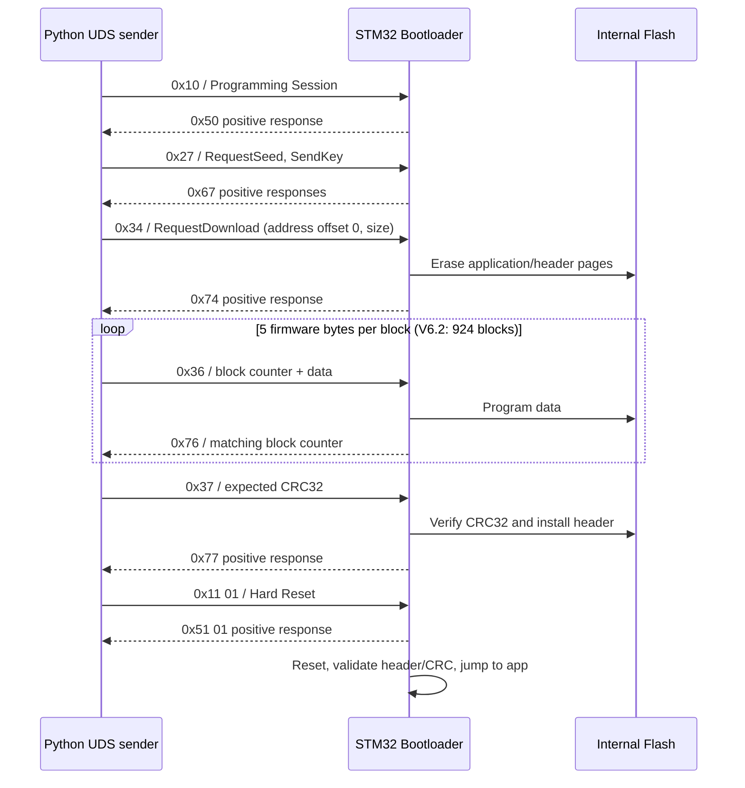

# STM32F103 Custom Bootloader — CAN & UDS Firmware Update


> **Verified outcome — 18 October 2026:** A custom bootloader on a physical STM32F103C8T6 received and programmed a *different* application through CAN-based UDS services. The update changed the application output from the onboard **PC13 LED** (toggle every **3 s**, V6.1) to an **external LED on PA8** (toggle every **1 s**, V6.2). All **924/924 UDS TransferData blocks** were acknowledged; the ECU accepted the CRC32 **`0x851DC03B`**, responded positively to ECUReset, and ran the new application. The PA8 behavior also survived a full power-off/power-on cycle. **The bootloader itself was not reflashed with ST-Link for this upgrade.**

## 1. Project overview

The goal is to understand and implement the complete embedded firmware-update path: ARM Cortex-M3 startup, independent linker regions, Flash erase/programming, vector table relocation, firmware integrity verification, classical CAN communication, and a practical subset of Unified Diagnostic Services (UDS).

**Demonstrated on real hardware:**

- Initial bootloader installation through **ST-Link / STM32CubeProgrammer**.
- CAN communication at **500 kbit/s**, first through a custom PING/ACK protocol using PCAN-View and Python.
- Custom CAN firmware updates with per-frame acknowledgements and CRC32 verification.
- UDS sessions (`0x10`), ECUReset (`0x11`), educational SecurityAccess (`0x27`), RequestDownload (`0x34`), TransferData (`0x36`), and RequestTransferExit (`0x37`).
- Successful non-destructive UDS negative-response tests and **two successful end-to-end UDS transfers**: reinstalling V6.1 and upgrading to V6.2.
- Observable GPIO behavior change from PC13 to PA8, with successful startup after hardware RESET and after complete power removal.

**Scope:** This is an educational, **custom single-frame UDS subset over classical CAN**. It is **not a complete ISO 14229 / ISO 15765-2 (ISO-TP) stack**, and its fixed XOR Seed/Key mechanism is **not cryptographic authentication**. Recovery from power loss *during* an update, rollback, anti-rollback, image signatures, and production-grade functional-safety/security requirements remain unvalidated.

## 2. Hardware architecture

```text
Windows PC
  | Python 3 + uv + python-can
  | - tools/bootloader_can_v6_1.py  (custom CAN protocol)
  | - tools/bootloader_uds_can.py   (UDS update workflow)
  v
CANable V1 / PCAN-USB-compatible interface
  | Classical CAN, 500 kbit/s
  | CANH / CANL / common GND
  v
3.3 V CAN transceiver
  | CAN1_TX = PA12    CAN1_RX = PA11
  v
STM32F103C8T6 Blue Pill (ARM Cortex-M3)
  |
  +-- Custom bootloader:        0x08000000–0x08003FFF
  |     CAN reception, UDS state machine, Flash erase/program,
  |     CRC32 validation, firmware header, reset and app jump
  |
  +-- Firmware header:         0x08004000 (16 bytes)
  |     1 KiB reserved:        0x08004000–0x080043FF
  |
  +-- Application vector table: 0x08004400
        V6.1: PC13, HAL_Delay(3000)
        V6.2: PA8,  HAL_Delay(1000) + external LED
```

| Component / software | Role |
|---|---|
| STM32F103C8T6 Blue Pill | MCU target: 64 KiB Flash, 20 KiB SRAM |
| 3.3 V CAN transceiver module | Converts CAN TX/RX logic to differential CANH/CANL signals |
| CANable V1 USB-C / PCAN-compatible interface | PC connection to the CAN bus |
| ST-Link V2 + STM32CubeProgrammer | Initial bootloader installation, full-Flash backup, recovery |
| STM32CubeIDE + STM32 HAL | Bootloader and application build |
| PCAN-View | Manual CAN/UDS requests and inspection of ECU responses |
| Python + `python-can` + `uv` | Firmware inspection and automated transfers |
| External LED + current-limiting resistor | V6.2 application output on PA8 |

**Wiring and startup:** For this configuration, **PA12 is CAN1_TX** and **PA11 is CAN1_RX**; verify the transceiver's actual input/output pin names and 3.3 V supply requirements. Connect CANH, CANL, and common GND. Use appropriate termination at the **two physical bus ends** (typically 120 Ω each), accounting for any termination already inside the adapter or module. The MCU must boot with **BOOT0 = 0** to execute the custom bootloader in user Flash. For V6.2, the external LED is wired **PA8 → current-limiting resistor → LED anode (+), LED cathode (−) → GND**. Power off before changing wires.

## 3. Memory organization and application jump

| Region | Start | End (inclusive) | Capacity |
|---|---|---|---:|
| Bootloader | `0x08000000` | `0x08003FFF` | 16 KiB |
| Firmware header reservation | `0x08004000` | `0x080043FF` | 1 KiB |
| Application | `0x08004400` | `0x0800FFFF` | 47 KiB |

The header occupies **16 actual bytes** at `0x08004000`; the remainder of the 1 KiB page is reserved. The application is linked at `0x08004400`, **not** at the normal STM32 Flash base.

```ld
/* Bootloader linker script */
FLASH (rx) : ORIGIN = 0x08000000, LENGTH = 16K

/* Application linker script */
FLASH (rx) : ORIGIN = 0x08004400, LENGTH = 47K
```

At `0x08004400`, the first 32-bit word specifies the application's initial **MSP** (stack pointer in SRAM). The next word specifies the **Reset_Handler** address (Thumb bit set). The bootloader validates the header and vector words, relocates `SCB->VTOR`, restores the execution environment, loads MSP and branches to the application's Reset_Handler. The application's `SystemInit()` must also use a compatible VTOR offset.

**Firmware header (little-endian, four 32-bit values):**

| Header offset | Field | Description |
|---|---|---|
| `+0x00` | Magic | `0xB00710AD` |
| `+0x04` | Firmware size | Application `.bin` size in bytes |
| `+0x08` | CRC32 | Standard CRC-32 calculated over application bytes |
| `+0x0C` | Version field | `0x00010000` in the current header implementation |

**Note on naming:** V6.1 and V6.2 refer to application/project demonstrations; the on-Flash header's `version` field is **not automatically incremented** to 6.1 or 6.2.

An earlier Debug build reported bootloader `text = 11064 B`, `data = 28 B`, `bss = 1872 B`, corresponding to approximately **11092 B of Flash** within the 16 KiB region; `.bss` occupies RAM. A linker `.map` file provides the definitive accounting for a given build.

## 4. Earlier custom CAN firmware-update protocol

The first fully validated update workflow used a compact proprietary protocol with **11-bit CAN IDs**:

| CAN ID | Direction | Purpose |
|---|---|---|
| `0x600` | PC → STM32 | Control: PING / START / ERASE / VERIFY / END |
| `0x601` | PC → STM32 | Firmware data blocks (2-byte sequence + up to 6 data bytes) |
| `0x602` | PC → STM32 | Firmware header blocks |
| `0x650` | STM32 → PC | ACK/NACK (five bytes) |

Control bytes: `P = 0x50` (PING), `S = 0x53` (START), `R = 0x52` (ERASE), `V = 0x56` (VERIFY), `E = 0x45` (END). An observed hardware exchange was:

```text
PC  -> STM32   ID 0x600   50
STM32 -> PC    ID 0x650   41 50 00 00 00   (PING ACK)
```

The ACK/NACK layout is `[0x41 ACK / 0x4E NACK, command context, seq_LSB, seq_MSB, error_code]`. The transfer waits for acknowledgements, writes internal Flash, installs the header, validates CRC32, and resets the MCU. An initial 4,624-byte installation and a V6.1 update were verified with **771/771 data ACK**, **3/3 header ACK**, and positive VERIFY/END responses.

The update erases **48 × 1 KiB Flash pages**, `0x08004000`–`0x0800FFFF`; the 16 KiB bootloader region lies outside that range in the implementation. An interrupted update can leave the application invalid. Keep the ST-Link available.

## 5. UDS-over-CAN implementation (hardware validated)

The newer workflow uses the same physical CAN bus at **500 kbit/s**, with **CAN request ID `0x7E0` and response ID `0x7E8`**. Each request/response is carried in a single classical CAN frame with a one-byte length prefix (single-frame PCI). **Multi-frame ISO-TP segmentation and flow control are not implemented.**

| UDS service | Implemented role | Validated hardware scenario |
|---|---|---|
| `0x10` — DiagnosticSessionControl | Default (`0x01`), Programming (`0x02`), Extended (`0x03`) | Positive responses; invalid subfunction rejected |
| `0x11` — ECUReset | Hard Reset (`0x01`) | Positive `0x51 01`; application restarted |
| `0x27` — SecurityAccess | RequestSeed (`0x01`) / SendKey (`0x02`) | Correct key accepted; wrong key and sequence errors rejected |
| `0x34` — RequestDownload | Authorize transfer and prepare application erase | Session, access, length and address-range errors rejected; valid download accepted |
| `0x36` — TransferData | Ordered firmware bytes, five payload bytes maximum per block | No-active-download error rejected; 924/924 blocks acknowledged for V6.2 |
| `0x37` — RequestTransferExit | Finalize, check CRC32, install header | No-active-transfer error rejected; CRC32 accepted on full update |

### 5.1 Diagnostic and security examples

The following bytes are *complete CAN data payloads*, including the first length byte:

| Request (`0x7E0`) | Response (`0x7E8`) | Interpretation |
|---|---|---|
| `02 10 02` | `06 50 02 00 32 01 F4` | Enter Programming Session |
| `02 27 01` | `06 67 01 12 34 56 78` | Request fixed demonstration seed |
| `06 27 02 B7 91 F3 DD` | `02 67 02` | Accept demonstration key |
| `02 11 01` | `02 51 01` | Positive ECUReset response |
| `02 11 02` | `03 7F 11 12` | Unsupported reset subfunction |

The educational key is computed as `key = seed XOR 0xA5A5A5A5`. The fixed seed and XOR mask are **insecure by design** and do not provide real firmware authentication.

### 5.2 Negative-response tests on the physical ECU

| Tested condition | Request | Observed response | NRC |
|---|---|---|---|
| RequestDownload outside Programming Session | `01 34` | `03 7F 34 22` | ConditionsNotCorrect (`0x22`) |
| RequestDownload with security locked | `01 34` | `03 7F 34 33` | SecurityAccessDenied (`0x33`) |
| Incomplete RequestDownload, session and access valid | `01 34` | `03 7F 34 13` | IncorrectMessageLengthOrInvalidFormat (`0x13`) |
| RequestDownload with disallowed nonzero address offset | `07 34 00 22 00 02 00 10` | `03 7F 34 31` | RequestOutOfRange (`0x31`) |
| TransferData without active download | `03 36 01 AA` | `03 7F 36 24` | RequestSequenceError (`0x24`) |
| RequestTransferExit without active download | `01 37` | `03 7F 37 24` | RequestSequenceError (`0x24`) |

SecurityAccess was also tested with a wrong key (`NRC 0x35`) and an invalid key-request sequence (`NRC 0x24`). These are **specific verified cases**, not an exhaustive diagnostic conformance test.

### 5.3 Complete UDS firmware-update sequence



Key protocol details:

- The current `0x34` format is `07 34 00 22 offset_hi offset_lo size_hi size_lo` with **zero offset** and a two-byte big-endian firmware size. Valid requests prepare a **destructive full application/header-area erase**.
- `0x36` sends `36 BSC data...`: an 8-bit **block sequence counter** and **1 to 5 firmware bytes** per request; a matching `0x76 BSC` is returned after successful programming. The counter wraps naturally from `255` to `0`.
- A correctly repeated previous block may be acknowledged without programming Flash twice; the sender retries data blocks on bounded timeouts.
- The full-update `0x37` request includes the **four-byte expected CRC32 in big-endian** order. The ECU verifies the image and writes its firmware header **before** returning `0x77`.
- A successful transport/CRC response is further validated by a separate **application behavior and reboot test**.

## 6. Firmware versions and physical results

| Firmware / demonstration | Binary size | CRC32 | Observable application behavior | CAN transfer result |
|---|---:|---|---|---|
| Initial custom-CAN demonstration | 4,624 B | `0xF7816A34` | Initial onboard PC13 LED pattern | 771 data ACK, 3 header ACK, VERIFY/END ACK |
| V6.1 | 4,624 B | `0x8513D353` | PC13 toggles every 3 seconds | Custom CAN update passed; UDS reinstallation: 925/925 blocks ACK |
| **V6.2** | **4,620 B** | **`0x851DC03B`** | **External LED on PA8 toggles every 1 second** | **UDS upgrade: 924/924 blocks ACK, `0x77` after CRC32, ECUReset ACK** |

**V6.2 image details:**

```text
File:             firmware/Application_V6_2_PA8.bin
MSP:              0x20005000
Reset_Handler:    0x0800471D
Linked app start: 0x08004400
Last image byte:  0x0800560B
RequestDownload:  07 34 00 22 00 00 12 0C
RequestTransferExit: 05 37 85 1D C0 3B
```

A **1-second toggle interval** means PA8 changes output state once per second; a full ON/OFF cycle lasts approximately **2 seconds**. For V6.1, PC13 toggled every 3 seconds (approximately 6 seconds per full cycle).

**Observed V6.2 validation:**

1. All six automated UDS stages completed successfully in Git Bash.
2. **924/924** data blocks received matching positive acknowledgements.
3. ECU accepted the CRC32 **`0x851DC03B`** at RequestTransferExit.
4. ECUReset produced a positive response; after setting **BOOT0 = 0**, the new PA8 LED behavior was observed.
5. After a **complete power-off and power-on**, the PA8 LED resumed its 1-second toggle pattern without further firmware download.

**Important distinction:** Power cycling **after a completed valid update** was tested successfully. Interrupting power **during erase/programming** was **not** tested as a recovery scenario.

## 7. Build, inspect and transfer firmware

### 7.1 Build the application

Use STM32CubeIDE to build `application/` (for the matching application configuration). The link origin must remain `0x08004400`, and the application must set the vector-table offset consistently. V6.2 uses `GPIOA / GPIO_PIN_8`, with PA8 configured as push-pull GPIO output in `Application.ioc`.

Enable **MCU Post build outputs → Convert to binary file**, then copy the built binary into `firmware/` with a descriptive version-specific filename. The `.bin` must correspond to the currently compiled application: do not reuse an older build artifact by mistake.

### 7.2 Commands from the repository root (Git Bash, Windows)

Inspect the image **without opening CAN or touching Flash**:

```bash
uv run --no-project python \
  projects/01-stm32-custom-bootloader/tools/bootloader_uds_can.py \
  plan \
  projects/01-stm32-custom-bootloader/firmware/Application_V6_2_PA8.bin
```

A separate command initiates an **actual destructive** update:

```bash
uv run --no-project --with python-can python \
  projects/01-stm32-custom-bootloader/tools/bootloader_uds_can.py \
  flash \
  projects/01-stm32-custom-bootloader/firmware/Application_V6_2_PA8.bin
```

`flash` first validates the image and requests the exact confirmation **`EFFACER`**. It then opens the PCAN-compatible interface (`PCAN_USBBUS1`, 500,000 bit/s) and prompts for a hardware RESET followed immediately by Enter, to enter the bootloader's approximately **3-second listening window** before a valid existing application starts.

**Before any destructive update:**

- Save and verify a backup of the current Flash using STM32CubeProgrammer; keep it **outside Git**.
- Keep **BOOT0 = 0** and stable power / CANH / CANL / GND connections.
- Disconnect PCAN-View from the CAN adapter and STM32CubeProgrammer from ST-Link so the Python tool can use the hardware without interference.
- Keep the ST-Link and a verified recovery procedure available.
- If the update fails after erasing the image, **do not assume the application can boot**. Diagnose and recover deliberately instead of retrying blindly.

**Hardware backup used for this demonstration:** a 65,536-byte Flash image was read starting at `0x08000000` before V6.2. Its 16-byte header, V6.1 vectors, CRC32 `0x8513D353`, and complete V6.1 application bytes were compared successfully. This file is intentionally **not committed** to the repository.

### 7.3 Legacy custom CAN sender

The previous firmware-update path remains available via `tools/bootloader_can_v6.py` and `tools/bootloader_can_v6_1.py`. These scripts use **IDs `0x600`–`0x602` / `0x650`**, rather than the UDS IDs `0x7E0` / `0x7E8`. Do not interchange the two sets of commands or assume they provide identical framing.

## 8. Project files

```text
projects/01-stm32-custom-bootloader/
├── README.md
├── bootloader/                      # STM32CubeIDE bootloader project
│   └── Core/Src/
│       ├── main.c                  # CAN, Flash, update orchestration, app jump
│       └── uds.c                   # Educational UDS service handlers
├── application/                     # STM32CubeIDE application project
│   ├── Application.ioc             # PA8 GPIO configuration for V6.2
│   ├── Core/Src/
│   │   ├── main.c                  # PA8 LED toggle (V6.2)
│   │   └── system_stm32f1xx.c     # Application VTOR relocation
│   └── STM32F103C8TX_FLASH.ld     # Application linker origin: 0x08004400
├── firmware/
│   ├── Application_V6_corrigee.bin
│   ├── Application_V6_1.bin
│   └── Application_V6_2_PA8.bin
├── tools/
│   ├── bootloader_can_v6.py
│   ├── bootloader_can_v6_1.py
│   └── bootloader_uds_can.py
└── docs/
    └── version-history.md
```

Other files and earlier simulation/testing scripts may also be present. The tree highlights files relevant to the real-hardware CAN/UDS demonstration. Compiled temporary files, personal full-Flash backups, and machine-local paths do not belong in the public repository.

## 9. Evidence to add last

**Screenshots, photos and video are intentionally deferred to the final documentation stage.** Only link to evidence when the real file has been added to the repository. Suggested files under `docs/evidence/`:

| Proposed file | What it should demonstrate |
|---|---|
| `01-hardware-wiring.jpg` | Real STM32 Blue Pill, CAN transceiver, USB-CAN adapter, wiring and PA8 LED |
| `02-can-ping-pcan.png` | Custom CAN `0x600` PING → `0x650` ACK |
| `03-uds-negative-responses.png` | Tested UDS refusal responses, e.g. `0x7F 34 31` |
| `04-uds-v6-2-transfer.png` | Python session/key/erase, **924/924 block ACK**, CRC32 and ECUReset |
| `05-pa8-v6-2-demo.mp4` | PA8 LED toggle every 1 second after programming and power cycle |

These are **suggested names**, not a claim that the media have already been uploaded.

## 10. Limitations and engineering next steps

- **No full ISO-TP support:** single-frame transport limits request/response size; no multiframe diagnostics.
- **Security is demonstrative:** fixed Seed/Key XOR (`0xA5A5A5A5`); no signatures, encrypted delivery, secure boot, or anti-rollback.
- **Atomicity/recovery not demonstrated:** no tested recovery after interrupting an update during erase/write; no A/B image fallback.
- **Diagnostics coverage is partial:** tested service and NRC examples are not full UDS conformance or fuzz testing.
- **Further fault injection:** malformed/duplicate/out-of-order blocks, corrupted firmware, interrupted CAN, low supply, timeout and bus-off cases.
- **Electrical reproducibility:** document final soldered wiring, power measurements and physical termination before claiming full electrical validation.
- **Automotive deployment:** ASPICE/ISO 26262/ISO 21434 processes and production-level requirements are outside the validated scope.

---

**Final validated outcome:** The STM32 bootloader accepted a new 4,620-byte V6.2 firmware via real CAN/UDS, positively acknowledged all 924 data blocks, confirmed CRC32 `0x851DC03B`, reset, and executed the new PA8 LED behavior; that behavior persisted through a full power cycle. The bootloader region remained unchanged by the application-only update workflow.

## Previous versions (V1–V5)

Earlier development stages are documented in [Version history](docs/version-history.md).
