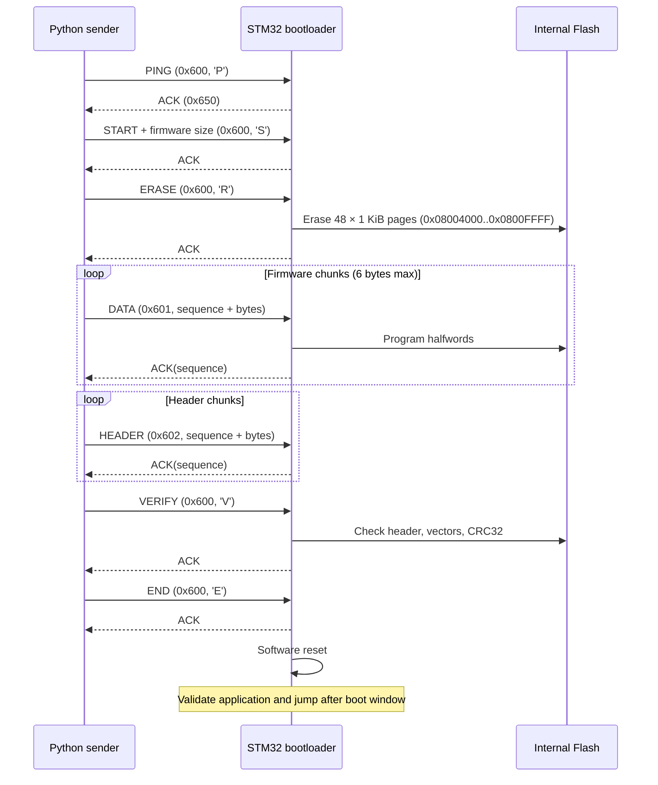

# STM32F103 Custom Bootloader — Firmware Update Over CAN


> **Result:** A custom embedded bootloader running on a real STM32F103C8T6 receives an application binary over classical CAN, programs internal Flash, verifies CRC-32, and starts the application. A second application update changed the PC13 LED toggle interval to **3 seconds**. The new behavior was observed after updating over CAN and persisted after a hardware RESET, without reflashing the bootloader using ST-Link.

## 1. Project overview

This project explores the STM32 startup process and implements a firmware update workflow on bare-metal STM32 HAL. The bootloader resides in a dedicated Flash region; the application is linked independently and can be replaced through a PC-to-CAN connection.

**Implemented and validated on physical hardware:**

- Initial bootloader programming and verification using ST-Link / STM32CubeProgrammer.
- Bidirectional `PING` / `ACK` exchange between the PC and STM32 over CAN at 500 kbit/s, using both PCAN-View and Python.
- Application area erase, firmware transfer with per-frame acknowledgements, Flash programming, firmware header creation, and CRC-32 integrity verification.
- Bootloader-to-application jump with MSP and vector-table relocation.
- Upgrade from the original application to a modified application (**V6.1 demonstration**) using CAN only.
- LED PC13 changing state every 3 seconds after the update; same behavior after a hardware RESET.

**Not claimed as fully validated:** power-loss recovery, communication interruption after partial programming, corrupted firmware rejection on hardware, UDS diagnostic workflows, security/authenticity, and production-grade bootloader reliability.

## 2. Demonstrated architecture

```text
Windows PC
  |  Application.bin
  |  Python firmware sender (python-can)
  v
CANable V1 (PCAN-USB interface)
  |
  | Classical CAN @ 500 kbit/s
  | CANH / CANL / common GND
  v
3.3 V CAN transceiver module
  |
  | CAN TX / RX (STM32 PA12 / PA11)
  v
STM32F103C8T6 Blue Pill
  |
  +-- Bootloader                 0x08000000
  |     | receive + acknowledge frames
  |     | erase / program internal Flash
  |     | verify firmware metadata and CRC32
  |     `-- reset + validate + jump
  |
  +-- Firmware header            0x08004000
  |
  `-- Application vector table   0x08004400
        `-- application main() -> toggle GPIOC pin 13
```

### Hardware and software

| Item | Purpose |
|---|---|
| STM32F103C8T6 Blue Pill | Target MCU (ARM Cortex-M3, 64 KiB internal Flash, 20 KiB SRAM) |
| ST-Link V2 and STM32CubeProgrammer | Install and verify the bootloader initially; recovery |
| CANable V1 USB-C | PC-side USB-to-CAN adapter, exposed as a PCAN-USB-compatible channel |
| 3.3 V CAN transceiver module | Physical CAN interface for STM32 CAN1 |
| Jumper wires and a shared ground | Bus and logic-level connections |
| STM32CubeIDE / HAL | Build bootloader and application |
| Python, `uv`, `python-can` | Generate transfer plan and send firmware |
| PCAN-View | Manual bus test (`PING` / `ACK`) |

**Important wiring notes:** For the configuration used, STM32 **PA12 = CAN1_TX** and **PA11 = CAN1_RX**. Connect logic TX to the corresponding transceiver input, and logic RX to the transceiver output, following the markings and datasheet of the particular module. CANH, CANL, and a shared GND connect both nodes. Termination must be confirmed at the *two physical bus ends* (typically 120 Ω each); module jumpers and built-in adapter termination differ by hardware. Do not blindly add extra termination. The exact hardware wiring and termination measurements have not been independently documented here.

## 3. Memory map

Flash address ranges for the **64 KiB** device:

| Region | Start | End, inclusive | Allocated size |
|---|---|---|---:|
| Bootloader | `0x08000000` | `0x08003FFF` | 16 KiB |
| Header reservation | `0x08004000` | `0x080043FF` | 1 KiB |
| Application region | `0x08004400` | `0x0800FFFF` | 47 KiB |

The actual firmware header uses **16 bytes** at `0x08004000`; the remainder of its 1 KiB reservation is not part of the application image.

Linker configuration:

```ld
/* Bootloader linker script */
FLASH (rx) : ORIGIN = 0x08000000, LENGTH = 16K

/* Application linker script */
FLASH (rx) : ORIGIN = 0x08004400, LENGTH = 47K
```

The application initial vector table begins at `0x08004400`:

- First word: initial **Main Stack Pointer (MSP)**, in SRAM.
- Second word: **Reset_Handler** address, with the Thumb-state bit set.
- The bootloader validates these words, relocates `SCB->VTOR`, loads MSP, then branches to the application's reset handler.
- The application's `SystemInit()` is configured to place VTOR at `0x08004400`.

**Firmware header (little-endian; four 32-bit fields):**

| Offset | Field | Value or meaning |
|---|---|---|
| `+0x00` | `magic` | `0xB00710AD` |
| `+0x04` | `firmware_size` | Binary length, in bytes |
| `+0x08` | `crc32` | CRC-32 of the application binary |
| `+0x0C` | `version` | `0x00010000` in the tested bootloader protocol |

**Versioning note:** “V6” and “V6.1” here distinguish project/application test iterations. In the tested protocol, the header's `version` value remained `0x00010000`; it was **not** automatically incremented when the PC13 interval changed.

### Flash consumption

A **Debug** bootloader build shown during hardware bring-up reported `text = 11064`, `data = 28`, `bss = 1872` bytes. Approximate Flash allocation was therefore **11092 / 16384 bytes** (67.7%). `.bss` occupies RAM; `text + data` approximates Flash use. Linker/map analysis is the authoritative source when additional sections are present.

## 4. Custom classical CAN protocol

Identifiers are 11-bit standard CAN IDs.

| CAN ID | Direction | Meaning |
|---|---|---|
| `0x600` | PC → STM32 | Control command |
| `0x601` | PC → STM32 | Firmware data |
| `0x602` | PC → STM32 | Header data |
| `0x650` | STM32 → PC | ACK / NACK response |
| `0x7E0` | PC → STM32 | UDS request path in source code; **not hardware-validated here** |
| `0x7E8` | STM32 → PC | UDS response path in source code; **not hardware-validated here** |

### Control commands on ID `0x600`

| ASCII command | Byte | Payload | Action |
|---|---|---|---|
| `P` | `0x50` | `50` | PING (non-destructive) |
| `S` | `0x53` | `53` followed by firmware size (`uint32`, LE) | START UPDATE |
| `R` | `0x52` | `52` | ERASE update area **(destructive)** |
| `V` | `0x56` | `56` | VERIFY header + application + CRC |
| `E` | `0x45` | `45` | END UPDATE and reset |

**Response on `0x650`, DLC 5:**

```text
Byte 0: 'A' ACK (0x41) or 'N' NACK (0x4E)
Byte 1: command context ('P', 'S', 'R', 'D', 'H', 'V', 'E')
Byte 2: sequence LSB
Byte 3: sequence MSB
Byte 4: error code (0 when successful)
```

An observed example is PING `0x600 [50]` → ACK `0x650 [41 50 00 00 00]`.

**Data transfer format, IDs `0x601` and `0x602`:**

```text
[sequence_LSB, sequence_MSB, up to 6 payload bytes]
```

The firmware sender waits for a matching positive acknowledgement before continuing. The target validates sequence order and data lengths. The transfer sender supports bounded retries on timeouts for data blocks, while ERASE and END are not automatically retried.

CAN negative response error codes in this implementation:

| Code | Error |
|---|---|
| `0x01` | Invalid state |
| `0x02` | Invalid length |
| `0x03` | Incorrect sequence |
| `0x04` | Flash programming error |
| `0x05` | Invalid header |
| `0x06` | CRC mismatch |
| `0x07` | Invalid size/range |

## 5. Update sequence



**Destructive operation:** `ERASE` covers **48 pages × 1024 bytes**, from `0x08004000` through `0x0800FFFF`. The bootloader region `0x08000000`–`0x08003FFF` is outside the erase range in the current code. An interrupted update can leave the application invalid; recovery and power-failure behavior need further testing. Keep the ST-Link available.

## 6. Building and using the firmware sender

### Build the application

1. Open `Application` in STM32CubeIDE.
2. Confirm its Flash linker origin is `0x08004400` and `SystemInit()` relocates VTOR accordingly.
3. Build with **0 errors / 0 warnings** and enable the post-build **binary output**.
4. Locate `Application/Debug/Application.bin` (or your active build configuration's output).
5. Copy the new `.bin` to the PC sender folder under a descriptive name.

### Windows terminal and Python

The physical demo used `uv` to avoid installing packages into a managed Python environment:

```powershell
# Non-destructive firmware checks (no CAN interface opened)
uv run --no-project --with python-can python bootloader_can_v6_1.py plan Application_V6_1.bin

# Non-destructive connectivity test while bootloader is active
uv run --no-project --with python-can python bootloader_can_v6_1.py ping

# Destructive app upgrade; requires explicit typed confirmation
uv run --no-project --with python-can python bootloader_can_v6_1.py flash Application_V6_1.bin
```

**Before `flash`:** use `BOOT0 = 0`, keep stable power and CAN wiring, close/disconnect PCAN-View and STM32CubeProgrammer, and keep ST-Link for recovery. The `flash` script first requests `EFFACER`, then prompts for a hardware RESET **before** starting PING and START UPDATE. Reset the STM32 and immediately press Enter in PowerShell to enter the bootloader's approximately 3-second update window while an existing valid application is present.

The sender used the PCAN-compatible `PCAN_USBBUS1` interface at 500,000 bit/s. The `plan` command calculates size, MSP, Reset_Handler, SHA-256, CRC32, header bytes and frame counts without contacting the MCU.

## 7. Hardware validation evidence (17 October 2026)

| Test | Observation | Status |
|---|---|---|
| Program Bootloader V6 | STM32CubeProgrammer: `Download verified successfully` | **Passed** |
| PCAN-View PING | `0x600: 50` → `0x650: 41 50 00 00 00` | **Passed** |
| Python PING | `PING reussi: ACK 0x650 / 41 50 00 00 00` | **Passed** |
| First firmware installation | 4,624 bytes; 771/771 DATA ACK; 3/3 HEADER ACK; VERIFY ACK; END ACK | **Passed** |
| Initial application boot | LED PC13 blinks; behavior persists after RESET | **Passed** |
| Updated application V6.1 | 4,624 bytes; transfer/VERIFY/END ACK | **Passed** |
| V6.1 behavior | PC13 changes state every 3 seconds, 6-second full cycle | **Passed** |
| V6.1 after RESET | PC13 still changes state every 3 seconds without reflashing the bootloader | **Passed** |

### Firmware images in the demonstration

| Application iteration | Size | CRC32 | Behavior |
|---|---:|---|---|
| First CAN-transferred application | 4,624 B | `0xF7816A34` | Original LED blink pattern |
| V6.1 CAN-updated application | 4,624 B | `0x8513D353` | `HAL_Delay(3000)` between PC13 toggles |

A **3-second toggle interval** means alternating ON/OFF states every 3 seconds, not a complete 3-second blink period. A full cycle is ~6 seconds (assuming active-low PC13 LED wiring and successful SysTick configuration).

### Suggested evidence files to add to the repository

Add your actual screenshots/photos in a folder like `docs/evidence/`:

- `01-pcan-ping-ack.png` — receive ID `0x650` and bytes `41 50 00 00 00`.
- `02-bootloader-programming-verified.png` — STM32CubeProgrammer success log.
- `03-python-ping.png` — Python PING result.
- `04-firmware-transfer-v6.png` — 771 DATA ACK, 3 HEADER ACK, VERIFY and END.
- `05-firmware-transfer-v6-1.png` — second update ACK results.
- `06-hardware-setup.jpg` — real Blue Pill, transceiver, CANable and wiring.
- `07-led-v6-1-demo.mp4` — LED PC13 changing state every 3 seconds, if recorded.

The names above are **suggested filenames**, not claims that those images or recordings are already present in the repository. Never add placeholder links to missing evidence files.

## 8. Source-code layout (recommended repository organization)

```text
projects/01-stm32-custom-bootloader/
├── README.md
├── bootloader/                 # CubeIDE Bootloader project
│   └── Core/Src/main.c
├── application/                # CubeIDE Application project
│   ├── Core/Src/main.c
│   ├── Core/Src/system_stm32f1xx.c
│   └── STM32F103C8TX_FLASH.ld
├── tools/
│   ├── bootloader_can_v6.py
│   └── bootloader_can_v6_1.py
└── docs/
    └── evidence/              # Actual screenshots and photos
```

This tree is a **suggested arrangement**; the source projects already exist and may currently store Python tools elsewhere. Avoid committing an unreviewed full-Flash backup or machine-specific build artifacts.

## 9. Known limitations and next tests

The successful demonstrations are not equivalent to a production-ready automotive ECU bootloader. Further work:

1. **Fault injection:** damaged payload, wrong sequence, lost ACK, invalid CRC, and out-of-range request.
2. **Reset/power-cut tests:** interrupt transfer or reset after ERASE, then recover without changing the bootloader.
3. **Resilience:** timeout policy, state-machine resets, bounded retries, duplicate-frame handling, and bus-off recovery.
4. **Protection:** firmware authenticity, anti-rollback, secure update decisions, and safe failure recovery.
5. **Diagnostics:** validate the existing UDS-related code paths on real hardware separately from the custom CAN transfer workflow.
6. **Electrical verification:** final soldering/connection integrity, 120 Ω terminations, stable supply, and CAN error counters.
7. **Reproducibility:** build instructions, code versions/tags, hardware photo, schematic, and archived test evidence.

---

**Validated outcome:** A PC tool successfully updated an STM32F103 application's binary through CAN, and a second update visibly changed LED behavior from the original pattern to a 3-second toggle interval. The new behavior persisted after hardware RESET, with the bootloader unchanged.
