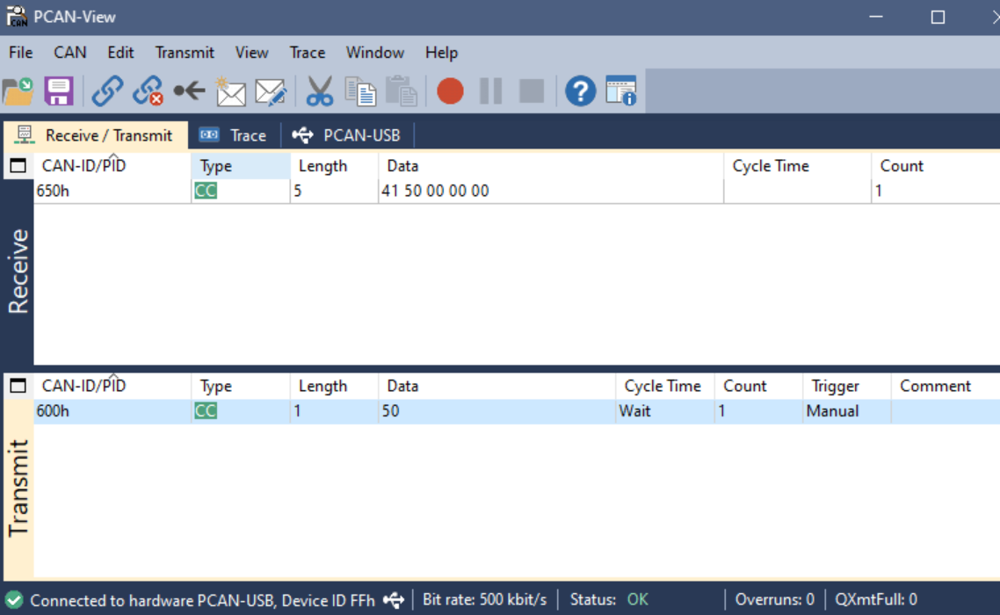
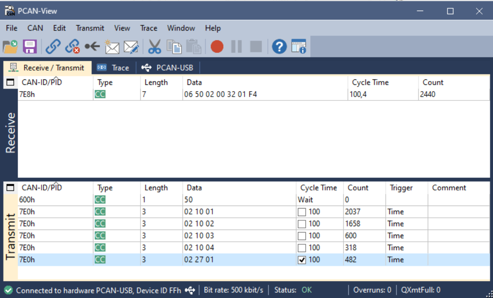
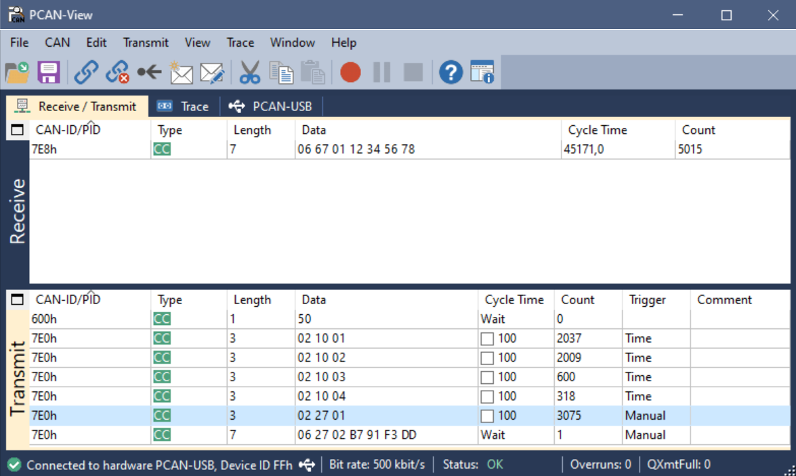
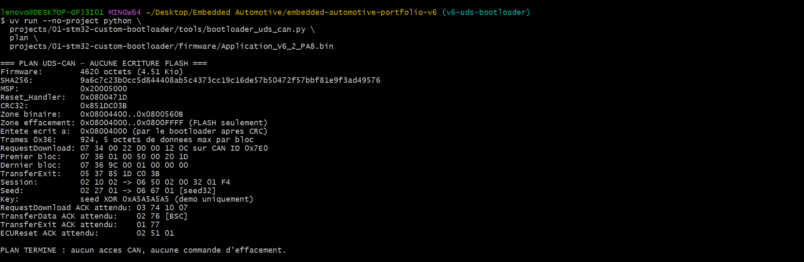
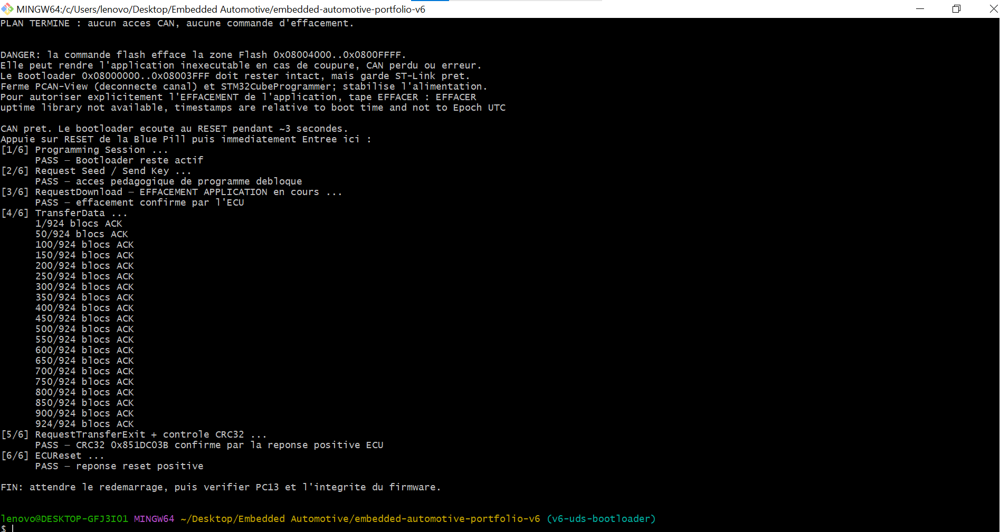
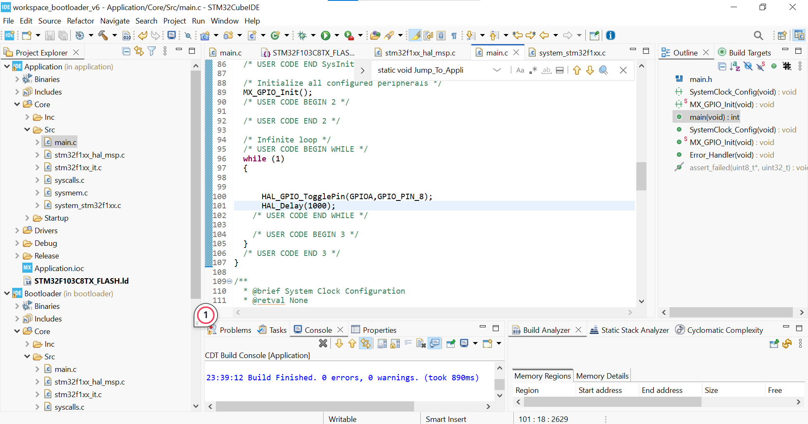
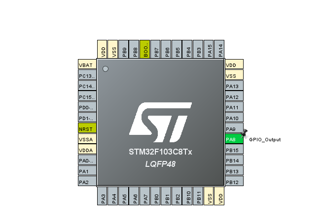
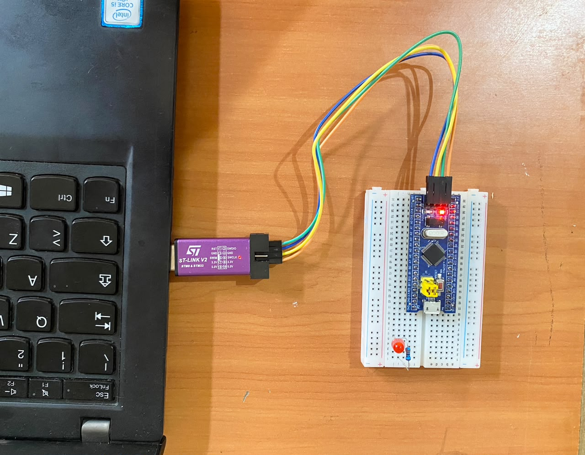
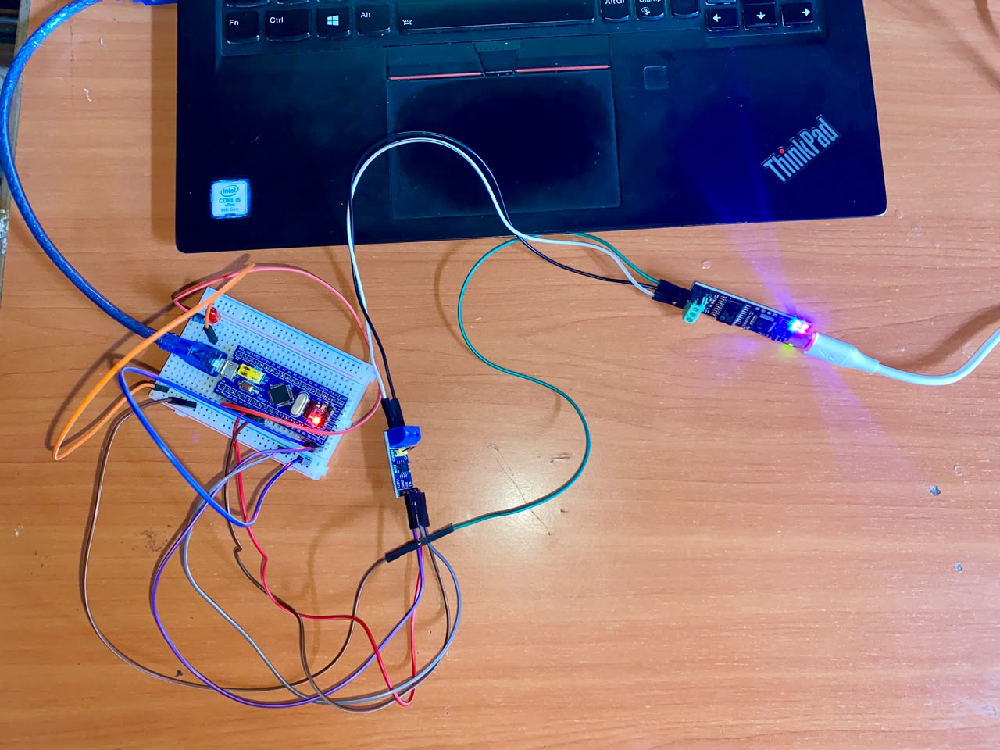

# Hardware evidence — STM32F103 Custom CAN/UDS Bootloader V6.2

Original photos and screenshots provided during the hardware implementation and tests. These images are **not simulated** or newly generated. Files 01–03 and 08–09 were renamed for documentation without changing the original image bytes. Screenshots 04–07 were cropped for readability; their SHA-256 digests in `MANIFEST.csv` have been updated to describe the included files.

## Test result

- Target: STM32F103C8T6 Blue Pill.
- CAN: 500 kbit/s.
- Firmware V6.2: 4,620 bytes, PC13 (V6.1) -> PA8 (V6.2).
- Programming: 924/924 TransferData blocks acknowledged; CRC32 `0x851DC03B`; positive ECU reset response.
- User-confirmed functional behavior: external PA8 LED toggles every second, including after full power-off and power-on.
- Scope: educational **single-frame custom UDS subset**, not a production automotive flashing stack.

## Selected evidence

### 01 — Earlier CAN PING (PCAN-View)

Earlier CAN V6 custom-protocol PING: request 0x600 with 0x50 and reply 0x650 with 41 50 00 00 00; not a UDS packet.

### 02 — UDS Programming Session (PCAN-View)

UDS programming session response 0x7E8 / 06 50 02 00 32 01 F4 captured in PCAN-View. Other transmit entries were test messages.

### 03 — UDS SecurityAccess seed (PCAN-View)

UDS SecurityAccess demonstration seed response 0x7E8 / 06 67 01 12 34 56 78 captured in PCAN-View. Not production cryptographic access control.

### 04 — V6.2 UDS dry-run plan

UDS V6.2 dry-run plan: 4620-byte firmware, 924 blocks, CRC32 0x851DC03B, no Flash writes.

### 05 — V6.2 UDS firmware update: 924 ACKs and CRC32

Successful physical V6.2 UDS update: programming session, seed/key, erase, 924/924 TransferData ACKs, CRC32 0x851DC03B and ECUReset positive.

### 06 — PA8 application source code (STM32CubeIDE)

STM32CubeIDE application loop toggling GPIOA pin 8 at a 1000 ms delay. Console visible in this screenshot refers to an earlier build.

### 07 — PA8 GPIO configuration (STM32CubeMX)

STM32CubeMX pinout showing PA8 assigned as GPIO_Output.

### 08 — Real STM32 Blue Pill with external LED and ST-Link

New real photograph showing a discrete red LED and series resistor on the breadboard near the STM32F103 Blue Pill, with an ST-Link V2 connected. This documents the external-LED setup. The exact MCU pin assignment and the one-second toggling interval cannot be verified from a single still photograph.

### 09 — Real CAN/UDS test bench

New real photograph of the STM32F103 Blue Pill bench setup, CAN transceiver interface board, USB-CAN adapter and PC cabling. This is physical hardware evidence, while protocol behavior is demonstrated separately by PCAN-View and transfer logs.

## Still to capture

**PA8 blinking demonstration:** a new photograph documents the STM32 with an external LED (image 08), but a *still image cannot prove the GPIO is PA8 or demonstrate a one-second toggle interval*. The timing and power-cycle behavior were user-observed. For independent evidence, add a short video showing the LED switching states and ideally the PA8 wiring / code in the same recording.

**Power-cycle evidence:** the application was reported to run after a complete power-off/power-on test. A short video would make this observation independently reviewable.

## Protocol notes

The CAN V6 PING uses standard identifiers `0x600`/`0x650`; later UDS tests and updates use `0x7E0`/`0x7E8`. Do not conflate these as one protocol. Seed/key is a fixed-mask educational demo, not cryptographic security.
