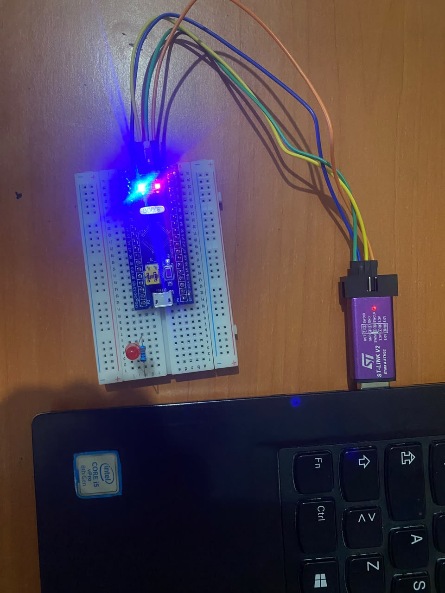
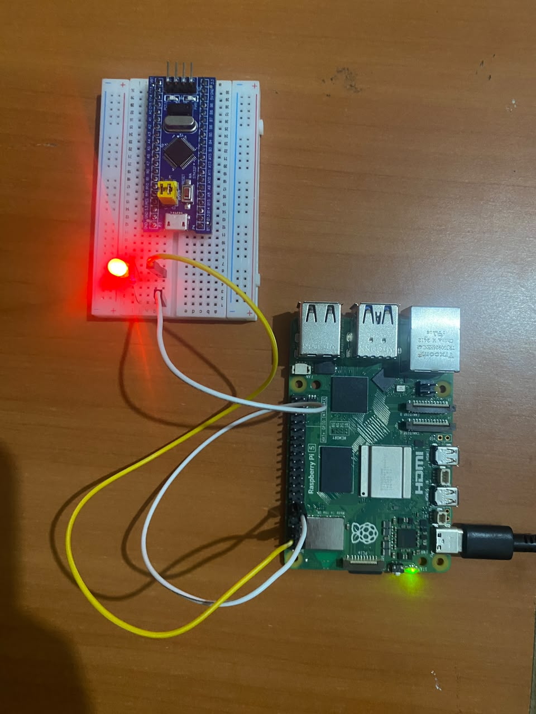
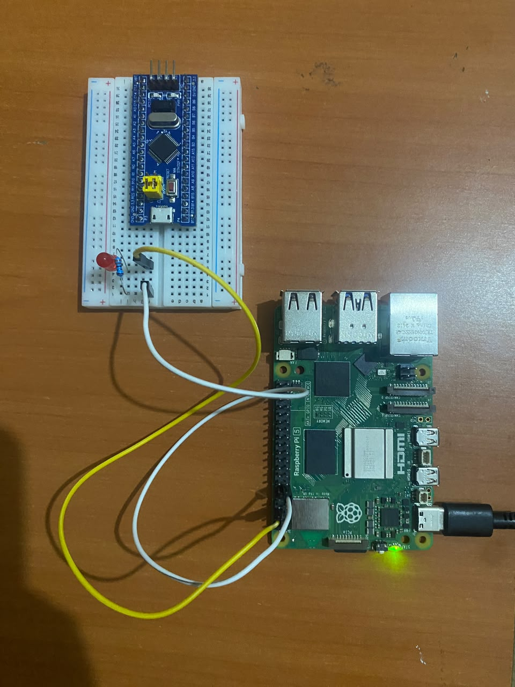

# AUTOSAR Classic Hardware-Independent SWC

AUTOSAR Classic demonstrator focused on **Application Layer portability across different hardware platforms**.

The project implements a periodic LED-control Application Software Component using **MATLAB/Simulink AUTOSAR Blockset**, generates C code and ARXML artifacts, and demonstrates that the same application logic can be reused on different hardware platforms without modifying the generated SWC.

The same `SWC_LedControl` application was validated on:

- PC Console ✅
- STM32F103C8T6 / Proteus ✅
- STM32F103C8T6 / Physical Hardware ✅
- Raspberry Pi 5 / Physical GPIO17 ✅

> This project demonstrates AUTOSAR Classic Application Layer concepts, RTE-style integration and hardware-independent software design.
>
> It is not intended to represent a complete production AUTOSAR Classic stack with commercial RTE, BSW and MCAL configuration.

---

## Project Objective

The main objective is to demonstrate that an AUTOSAR Application Software Component can remain independent from the hardware platform.

The application logic remains unchanged:

```text
SWC_LedControl.c
```

while only the hardware-specific implementation changes between targets.

```text
                     SAME AUTOSAR SWC
                      SWC_LedControl
                            |
                       Rte_IWrite()
                            |
                       RTE Adapter
                            |
                      Led_Hw_Write()
                       /          \
                      /            \
                     v              v
               STM32F103        Raspberry Pi 5
               STM32 HAL          libgpiod
                  |                  |
                 PC13              GPIO17
                  |                  |
                LED ✅              LED ✅
```

---

# AUTOSAR Concepts Demonstrated

The project applies the following AUTOSAR Classic concepts:

- Application Software Component
- Runnable Entity
- Timing Event
- Sender/Receiver communication
- P-Port
- Variable Data Prototype
- Boolean Application Data Type
- ARXML generation
- RTE data-access interface
- `Rte_IWrite()`
- Application Layer / hardware separation
- Hardware-independent SWC design

---

# Software Component

The AUTOSAR component was modeled using MATLAB/Simulink AUTOSAR Blockset.

```text
Component      : SWC_LedControl
Type           : Application SWC

Runnable       : SWC_LedControl_Step
Init Runnable  : SWC_LedControl_Init
Timing Event   : 500 ms

P-Port         : LedCommand
Data Element   : LedCommand
Data Type      : boolean

Communication  : Sender / Receiver
Access Mode    : ImplicitSend
```

The application output is written through the generated RTE interface:

```c
Rte_IWrite_SWC_LedControl_Step_LedCommand_LedCommand(...);
```

The generated Application SWC does not directly access STM32 GPIO registers, STM32 HAL or Raspberry Pi GPIO APIs.

---

# Application Logic

The generated SWC implements a simple periodic toggle behavior.

Conceptually:

```text
Previous LED state
       |
       v
  LedCommand
       |
       v
 Rte_IWrite()
       |
       v
Invert previous state
       |
       v
Store for next execution
```

The runnable is called every:

```text
500 ms
```

which produces a blinking LED on the target hardware.

---

# Software Architecture

```text
                +---------------------------+
                |      Application Layer    |
                |                           |
                |      SWC_LedControl       |
                |                           |
                | Runnable: Step()          |
                | Timing Event: 500 ms      |
                +-------------+-------------+
                              |
                         Rte_IWrite()
                              |
                              v
                +---------------------------+
                |        RTE Adapter        |
                |       Rte_Adapter.c       |
                +-------------+-------------+
                              |
                        Led_Hw_Write()
                              |
                              v
                +---------------------------+
                |   Common Hardware API     |
                |        Led_Hw.h           |
                +-------------+-------------+
                              |
             +----------------+----------------+
             |                |                |
             v                v                v
        PC Console       STM32F103       Raspberry Pi 5
          printf()        STM32 HAL         libgpiod
                              |                |
                            PC13             GPIO17
                              |                |
                             LED              LED
```

---

# RTE Adapter

The Simulink-generated SWC expects an AUTOSAR RTE interface.

For this educational demonstrator, a lightweight RTE-compatible adapter implements the required API:

```c
void Rte_IWrite_SWC_LedControl_Step_LedCommand_LedCommand(boolean u);
```

The adapter forwards the application command to the common hardware abstraction API:

```c
Led_Hw_Write(ledCommand);
```

Flow:

```text
SWC_LedControl
      |
      | Rte_IWrite()
      v
Rte_Adapter.c
      |
      | Led_Hw_Write()
      v
Platform-specific implementation
```

This adapter is used for demonstration and testing purposes and does not represent a full production AUTOSAR RTE.

---

# Hardware Abstraction

A common hardware interface is used by every target:

```c
void Led_Hw_Init(void);
void Led_Hw_Write(boolean state);
```

The AUTOSAR Application SWC does not know which hardware implementation is used.

The platform implementations are:

```text
PC
└── Led_Hw_Console.c

STM32F103
└── Led_Hw_STM32.c

Raspberry Pi 5
└── Led_Hw_RaspberryPi.c
```

This separation is the key portability principle demonstrated by the project.

---

# Target 1 — PC Console

The first validation target was a PC console application.

The hardware abstraction implementation converts the LED command into terminal output.

```text
SWC_LedControl
      |
      v
Rte_IWrite()
      |
      v
Rte_Adapter
      |
      v
Led_Hw_Console
      |
      v
LED ON / LED OFF
```

This target was used to validate the generated application logic before hardware integration.

**Status:** ✅ Validated

---

# Target 2 — STM32F103C8T6

The same generated AUTOSAR SWC was integrated on a real **STM32F103C8T6 Blue Pill**.

Platform:

```text
MCU          : STM32F103C8T6
CPU          : ARM Cortex-M3
Framework    : STM32 HAL
GPIO         : PC13
IDE          : STM32CubeIDE
Configuration: STM32CubeMX
Programmer   : ST-Link V2
```

The STM32-specific hardware implementation uses:

```c
HAL_GPIO_WritePin(...)
```

The runtime chain is:

```text
SWC_LedControl_Step()
        |
        v
Rte_IWrite()
        |
        v
Rte_Adapter.c
        |
        v
Led_Hw_STM32.c
        |
        v
HAL_GPIO_WritePin()
        |
        v
PC13
        |
        v
LED
```

The same implementation was first validated in Proteus and then on the physical STM32F103 hardware.

---

## STM32 Proteus Validation

The STM32 firmware was loaded into Proteus and the LED behavior was successfully simulated.

**Status:** ✅ Validated

---

## STM32 Physical Hardware Validation

The application was programmed on a physical STM32F103C8T6 using an ST-Link V2.

The LED behavior was successfully observed on real hardware.



**Result:** ✅ Physical execution successfully validated.

---

# Target 3 — Raspberry Pi 5

The same generated `SWC_LedControl.c` was also compiled and executed on a **Raspberry Pi 5**.

Platform:

```text
Board        : Raspberry Pi 5
OS           : Raspberry Pi OS 64-bit
Architecture : ARM64 / aarch64
GPIO API     : libgpiod 2.x
GPIO         : GPIO17
Compiler     : GCC
```

The Raspberry Pi-specific hardware abstraction uses `libgpiod`.

Runtime chain:

```text
SWC_LedControl_Step()
        |
        v
Rte_IWrite()
        |
        v
Rte_Adapter.c
        |
        v
Led_Hw_RaspberryPi.c
        |
        v
libgpiod
        |
        v
GPIO17
        |
        v
LED
```

GPIO17 was successfully detected on the Raspberry Pi GPIO controller:

```text
gpiochip0 17 "GPIO17"
```

---

## Raspberry Pi Physical Hardware Validation

The program was compiled directly on the Raspberry Pi 5 as a native ARM64 executable.

The generated executable was confirmed as:

```text
ELF 64-bit
ARM aarch64
```

The external LED connected to GPIO17 successfully toggled every 500 ms.

### LED ON



### LED OFF



**Result:** ✅ Physical GPIO17 execution successfully validated.

---

# Hardware Portability Demonstration

The central result of this project is that the generated AUTOSAR Application Software Component remained unchanged between the different execution targets.

Common application:

```text
SWC_LedControl.c
```

Common RTE adaptation:

```text
Rte_Adapter.c
```

Common hardware interface:

```text
Led_Hw.h
```

Only the hardware-specific implementation changes:

```text
PC Console
    |
    └── Led_Hw_Console.c

STM32F103
    |
    └── Led_Hw_STM32.c

Raspberry Pi 5
    |
    └── Led_Hw_RaspberryPi.c
```

Therefore:

```text
Application behavior
        |
        | unchanged
        v
SWC_LedControl
        |
        v
Common interface
        |
        v
Platform-specific hardware adaptation
```

---

# Generated AUTOSAR Artifacts

The project contains the generated AUTOSAR description files:

```text
SWC_LedControl_component.arxml
SWC_LedControl_interface.arxml
SWC_LedControl_datatype.arxml
SWC_LedControl_implementation.arxml
```

These files describe elements such as:

- Application SWC
- Port interfaces
- Sender/Receiver communication
- Data elements
- Implementation data types
- Runnable entities
- Timing events
- SWC implementation

---

# Repository Structure

```text
04-autosar-hardware-independent-swc/
│
├── README.md
│
├── simulink/
│   └── SWC_LedControl.slx
│
├── arxml/
│   ├── SWC_LedControl_component.arxml
│   ├── SWC_LedControl_interface.arxml
│   ├── SWC_LedControl_datatype.arxml
│   └── SWC_LedControl_implementation.arxml
│
├── common/
│   │
│   ├── app/
│   │   ├── SWC_LedControl.c
│   │   ├── SWC_LedControl.h
│   │   ├── SWC_LedControl_private.h
│   │   └── SWC_LedControl_types.h
│   │
│   ├── rte/
│   │   ├── Rte_Adapter.c
│   │   ├── Rte_SWC_LedControl.h
│   │   └── Rte_Type.h
│   │
│   ├── compat/
│   │   ├── Compiler.h
│   │   ├── Platform_Types.h
│   │   └── Std_Types.h
│   │
│   └── platform/
│       └── Led_Hw.h
│
├── targets/
│   │
│   ├── pc-console/
│   │   ├── Led_Hw_Console.c
│   │   └── main.c
│   │
│   ├── stm32/
│   │   ├── AUTOSAR_LED_STM32.ioc
│   │   ├── Led_Hw_STM32.c
│   │   └── main.c
│   │
│   └── raspberry-pi-5/
│       ├── Led_Hw_RaspberryPi.c
│       ├── main_rpi.c
│       ├── Makefile
│       └── README_RPI.md
│
├── proteus/
│   └── autosar.pdsprj
│
└── docs/
    ├── architecture.md
    └── images/
        ├── stm32f103-hardware-validation.jpg
        ├── raspberry-pi5-led-on.jpg
        └── raspberry-pi5-led-off.jpg
```

---

# Build — PC Console

From the project root:

```bash
gcc -Wall -Wextra -std=c11 \
-Icommon/app \
-Icommon/rte \
-Icommon/compat \
-Icommon/platform \
common/app/SWC_LedControl.c \
common/rte/Rte_Adapter.c \
targets/pc-console/Led_Hw_Console.c \
targets/pc-console/main.c \
-o targets/pc-console/led_console
```

Run:

```bash
./targets/pc-console/led_console
```

Expected behavior:

```text
LED OFF
LED ON
LED OFF
LED ON
...
```

---

# Build — Raspberry Pi 5

Required packages:

```bash
sudo apt update
sudo apt install -y build-essential gcc make git pkg-config gpiod libgpiod-dev
```

Check GPIO17:

```bash
gpioinfo GPIO17
```

Example result:

```text
gpiochip0 17 "GPIO17" input
```

Compile from the project root:

```bash
gcc -Wall -Wextra -std=c11 \
-D_POSIX_C_SOURCE=199309L \
-Icommon/app \
-Icommon/rte \
-Icommon/compat \
-Icommon/platform \
common/app/SWC_LedControl.c \
common/rte/Rte_Adapter.c \
targets/raspberry-pi-5/Led_Hw_RaspberryPi.c \
targets/raspberry-pi-5/main_rpi.c \
$(pkg-config --cflags --libs libgpiod) \
-o targets/raspberry-pi-5/autosar_led
```

Run:

```bash
sudo ./targets/raspberry-pi-5/autosar_led
```

Expected initialization:

```text
Found GPIO17 on /dev/gpiochip0, offset 17
Raspberry Pi LED initialized
```

The LED connected to GPIO17 then toggles every 500 ms.

---

# Raspberry Pi Wiring

```text
Raspberry Pi 5

GPIO17 / Physical Pin 11
        |
        v
      330 Ω
        |
        v
      LED (+)
        |
        v
      LED (-)
        |
        v
GND / Physical Pin 6
```

Simplified:

```text
GPIO17 ─── 330 Ω ───>|─── GND
                     LED
```

---

# STM32 Integration

The STM32 application initializes the GPIO and AUTOSAR component:

```c
MX_GPIO_Init();

Led_Hw_Init();
SWC_LedControl_Init();
```

The runnable is periodically executed:

```c
while (1)
{
    SWC_LedControl_Step();
    HAL_Delay(500);
}
```

The platform-specific implementation maps the common LED interface to PC13 using STM32 HAL.

---

# Validation Status

| Feature / Target | Status |
|---|---|
| Simulink AUTOSAR model | ✅ |
| Application SWC generation | ✅ |
| Runnable configuration | ✅ |
| Timing Event configuration | ✅ |
| Sender/Receiver interface | ✅ |
| C code generation | ✅ |
| ARXML generation | ✅ |
| RTE adapter integration | ✅ |
| PC Console execution | ✅ |
| STM32 / Proteus simulation | ✅ |
| STM32F103 physical hardware | ✅ |
| Raspberry Pi 5 ARM64 compilation | ✅ |
| Raspberry Pi GPIO17 control | ✅ |
| Raspberry Pi physical hardware | ✅ |
| Same Application SWC across targets | ✅ |

---

# Production AUTOSAR Comparison

This project focuses specifically on:

```text
Application SWC
      |
      v
RTE interface
      |
      v
Hardware abstraction
```

A production AUTOSAR Classic ECU would typically use an architecture closer to:

```text
Application SWC
       |
       v
      RTE
       |
       v
 Basic Software
       |
       v
    IoHwAb
       |
       v
 DIO / PORT
       |
       v
     MCAL
       |
       v
Microcontroller
```

Commercial AUTOSAR development environments may also provide configuration and generation of:

- RTE
- AUTOSAR OS
- COM
- PduR
- CanIf
- DCM
- DEM
- NvM
- MCAL modules

These modules are outside the scope of the current demonstrator.

---

# Tools & Technologies

### AUTOSAR / Model-Based Development

- AUTOSAR Classic fundamentals
- MATLAB R2024a
- Simulink
- AUTOSAR Blockset
- ARXML
- RTE interfaces

### Embedded

- Embedded C
- STM32F103C8T6
- ARM Cortex-M3
- STM32 HAL
- STM32CubeMX
- STM32CubeIDE
- ST-Link V2

### Linux / Raspberry Pi

- Raspberry Pi 5
- Raspberry Pi OS 64-bit
- GCC
- Linux
- libgpiod
- GPIO character-device interface
- SSH

### Validation

- Proteus 9
- Physical STM32 hardware
- Physical Raspberry Pi hardware

### Development

- Git
- GitHub
- GCC / MinGW
- VS Code

---

# Skills Demonstrated

This project demonstrates practical experience with:

- AUTOSAR Classic Application Layer fundamentals
- Application Software Components
- Runnable Entities
- Timing Events
- Sender/Receiver communication
- RTE data access
- ARXML generation
- Generated Embedded C integration
- Hardware abstraction
- Cross-platform software portability
- STM32 HAL integration
- Raspberry Pi Linux GPIO
- Native ARM64 compilation
- Embedded software architecture
- Hardware/software integration
- Physical validation
- Git-based project organization

---

# Final Result

The same generated AUTOSAR Application Software Component was successfully executed on two fundamentally different hardware/software environments:

```text
              SWC_LedControl
                    |
               Rte_IWrite()
                    |
               RTE Adapter
                    |
             Led_Hw interface
               /          \
              /            \
             v              v
       STM32F103        Raspberry Pi 5
       Cortex-M3           ARM64
       Bare-metal/HAL      Linux
       STM32 HAL           libgpiod
          PC13              GPIO17
            |                 |
          LED ✅             LED ✅
```

The Application SWC remained unchanged.

Only the hardware-specific adaptation layer was replaced.

This validates the main objective of the project:

> **Separate application functionality from hardware-specific implementation to improve software portability and reuse.**

---

## Project Status

**✅ Completed — Software and physical hardware validation achieved on STM32F103C8T6 and Raspberry Pi 5.**